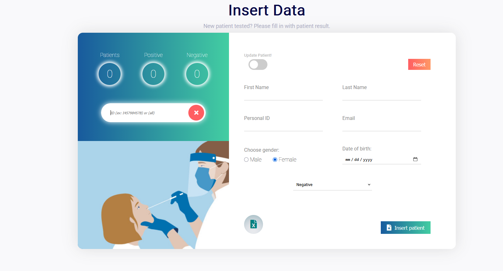

# 🧬 PCR System

<p align="center">
  
  
  
  
  
</p>
<p align="center">
  
  </p>

A lightweight **PCR Test Management System** built with **Node.js** and **Express**.

The application allows healthcare organizations and laboratories to manage PCR test records, generate digitally signed PDF reports with QR verification, send results via email, and export patient data.

---

# ✨ Features

- ✅ Register new PCR test records
- ✅ Automatic QR Code generation
- ✅ PDF certificate generation
- ✅ Patient lookup by Personal ID
- ✅ Public verification page
- ✅ Email delivery of PCR certificates
- ✅ Excel export
- ✅ ZIP export of all generated PDFs
- ✅ Statistics endpoint
- ✅ SQLite database
- ✅ REST API

---

# 🏗 Tech Stack

| Technology | Purpose |
|------------|----------|
| Node.js | Backend Runtime |
| Express | REST API |
| SQLite | Database |
| Multer | File Upload |
| Nodemailer | Email Service |
| PDF-Lib | PDF Generation |
| QRCode | QR Generation |
| ExcelJS | Excel Export |
| Archiver | ZIP Export |
| Luxon | Date Handling |
| Winston | Logging |
| PM2 | Production Process Manager |

---

# 📁 Project Structure

```
src/
│
├── app.js
├── db/
├── mail/
├── exportData/
├── public/
│   ├── css/
│   ├── js/
│   ├── assets/
│   └── index.html
│
└── utils/
```

---

# 🚀 Installation

Clone the repository

```bash
git clone https://github.com/KridiRamilli/PcrSystem.git
```

Install dependencies

```bash
npm install
```

---

# ▶ Run Development

```bash
npm run dev
```

---

# ▶ Production

```bash
npm start
```

The server will start on

```
http://localhost:3000
```

---

# ⚙ Environment Variables

Create a `.env` file.

Example:

```env
PORT=3000

EMAIL_USER=example@gmail.com
EMAIL_PASSWORD=yourpassword

DATABASE=database.sqlite
```

---

# 📡 API Endpoints

## Home

```
GET /
```

Returns the web interface.

---

## Generate PCR Test

```
POST /generate
```

Creates:

- Patient record
- PDF certificate
- QR Code
- Database entry

Example body

```json
{
  "name":"John",
  "lname":"Doe",
  "sex":"Male",
  "birthday":"1995-05-12",
  "result":"Negative",
  "personalId":"K12345678",
  "email":"john@example.com"
}
```

---

## Search Patient

```
POST /search
```

Example

```json
{
    "personalId":"K12345678"
}
```

If

```json
{
    "personalId":"ALL"
}
```

the system exports all generated PDFs as a ZIP archive.

---

## Statistics

```
GET /stats
```

Returns system statistics.

---

## Export Excel

```
POST /export
```

Exports patient data into Excel.

---

## Verify PCR Certificate

```
GET /me/:id
```

Returns the generated PDF associated with the QR Code.

---

# 📄 Generated Documents

Each generated PCR certificate contains

- Patient Information
- Result
- Approval Date
- QR Verification Code
- Unique Reference Number

---

# 📧 Email Notifications

The system can automatically send PCR certificates directly to the patient's email using **Nodemailer**.

---

# 📊 Export Options

Supported exports include:

- Excel (.xlsx)
- ZIP Archive containing all generated PDFs

---

# 🔒 Security

- Unique UUID for every PCR certificate
- QR verification
- Input validation
- SQLite persistent storage

---

# 📝 Development Scripts

```bash
npm run dev
```

Development mode with Nodemon.

```bash
npm run sass
```

Compile SCSS.

```bash
npm test
```

Run Jest tests.

```bash
npm run lint
```

Run ESLint.

---

# 📌 Future Improvements

- JWT Authentication
- User Roles
- Admin Dashboard
- Docker Support
- PostgreSQL Support
- Multi-language Interface
- Digital Signature Support
- Cloud Storage
- Audit Logs

---

# 👨‍💻 Author

**Kridi Ramilli**

GitHub:

https://github.com/KridiRamilli

---

# 📄 License

This project is released under the MIT License.
